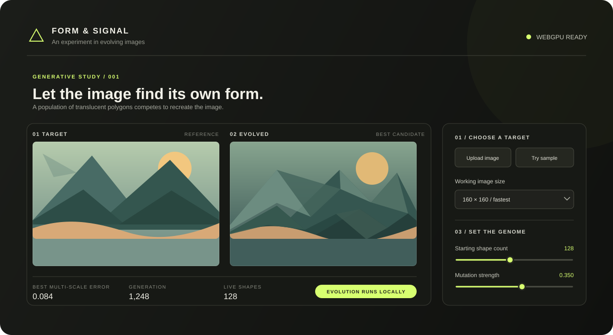

# Form & Signal — Image Evolution

A browser-based WebGPU experiment that evolves a picture from translucent polygon shapes. Candidate genomes are rendered and scored on your GPU, and the best result is shown alongside the target as evolution progresses.

On wide screens, focus and simplification (steps 4 and 5) appear in their own panel to the right of the main controls. At narrower widths, that panel moves below the image and main controls.

## Live demo

Try **[Form & Signal on GitHub Pages](https://sevendc.github.io/evolution-graphics/)**. The page and its preview artwork are hosted with this repository; uploaded images and genome data stay in your browser.



## Requirements

- Node.js (no third-party packages are required)
- A recent browser with WebGPU support, such as Chrome or Edge
- A WebGPU-compatible device and driver

The app must be served from a secure context. `localhost` is supported for local development.

## Run locally

From the project directory:

```sh
npm start
```

Open [http://localhost:8080](http://localhost:8080). The server binds to `127.0.0.1` by default. To use a different host or port, set the `HOST` or `PORT` environment variables before running `npm start`.

## Use

1. Choose **Upload image** or **Try sample** to set the target, then select a working image size from 160 × 160 to 1,024 × 1,024. Larger sizes preserve more detail but need more GPU time; changing the size restarts evolution.
2. Select **Auto mode** for a hands-off coarse-to-fine run, or set the starting shape count, mutation strength, shape/point change chance, maximum points per shape, and candidates per generation manually.
3. Auto mode begins with one shape for a new target (or continues from an existing best/imported genome), gradually lowers mutation over 4,000 generations, and increases shape complexity every 1,000 generations. It runs continuously between previews, updating its settings every 100 generations. Starting at generation 4,000, it may focus guided mutations on a small, detailed, high-error area for 25 generations every 3,000 generations; otherwise it searches globally. At the 512-shape limit it automatically analyzes and keeps a 10% simplification when successful. Select **Stop auto mode** to preserve the current best and restore manual controls.
4. For manual evolution, select **Start evolution**. Pause or resume with the same button; use the reset button to restart with the current settings.
5. To guide manual evolution, drag a rectangle on the target image. Adjust **Guided mutations in selection** to control how often guided mutations target it; focused proposals mix high-error samples with random samples from the target image, using sampled colors and varied polygon shapes to add detail. Manual focus expires after 1,500 completed generations; clear it earlier to return to global guidance. Fitness always scores the full image.
6. Compare the best candidate with the target. A lower multi-scale error means a closer match. Live statistics are shown below the image comparison.
7. Once a result is available, choose a removal percentage and analyze simplification. The app scores leave-one-shape-out variants, previews removing the least-impactful shapes, and shows the fitness change. Keep the preview to continue from the smaller genome, or discard it to restore the previous result.
8. Save the evolved image as PNG or export its genome as TOON. Import a TOON file or paste its text to seed a run.

The genome supports up to 512 shapes and 16 points per shape; the complexity slider controls the mutation limit, from triangles (3 points) through 16-point polygons. Mutation strength ranges from 0.001 to 0.7. The population setting ranges up to 2,048 candidates per generation. Larger values can use substantially more GPU time; reduce the population if the page becomes sluggish. Changing the starting shape count resets evolution, while population, structural mutation, and complexity settings can be adjusted during a run.

TOON version 1 triangle genomes remain supported and are still exported when every shape has three points. Genomes containing polygons use TOON version 2 with a `shapes[N]{vertices,r,g,b,opacity,points}:` table; each row stores the point count, color, opacity, then its x/y point pairs.

## Project files

- [`index.html`](./index.html) — Application markup and relative links to its stylesheet and JavaScript entry point.
- [`styles.css`](./styles.css) — Application styling and responsive layout.
- [`assets/form-and-signal-preview.svg`](./assets/form-and-signal-preview.svg) — Original vector preview artwork used in this README and hosted with the site.
- [`js/main.js`](./js/main.js) — Application startup, UI behavior, and evolution orchestration.
- [`js/media.js`](./js/media.js) — Sample artwork rendering and local image loading helpers.
- [`js/genome.js`](./js/genome.js) — TOON genome parsing, serialization, and downloads.
- [`js/gpu/shaders.js`](./js/gpu/shaders.js) — WGSL shader source used by WebGPU.
- [`server.js`](./server.js) — Minimal static-file server used by `npm start`.
- [`package.json`](./package.json) — Project metadata and start script.
- [`documentation/plans.md`](./documentation/plans.md) — Living list of future feature ideas, fixes to investigate, risks, and acceptance criteria.
- [`plan.md`](./plan.md), [`plan2.md`](./plan2.md), [`plan3.md`](./plan3.md), and [`plan4.md`](./plan4.md) — Implementation notes and follow-up ideas.
- [`whatsapp-image-2024-09-12-at-17-15-37_4652b8f4-genome.toon`](./whatsapp-image-2024-09-12-at-17-15-37_4652b8f4-genome.toon) — Example TOON genome.

JavaScript imports and stylesheet links use relative paths so the app also works when deployed under a GitHub Pages repository path. The application processes images locally in the browser; it does not upload them to a server. There is currently no automated test script in `package.json`.
